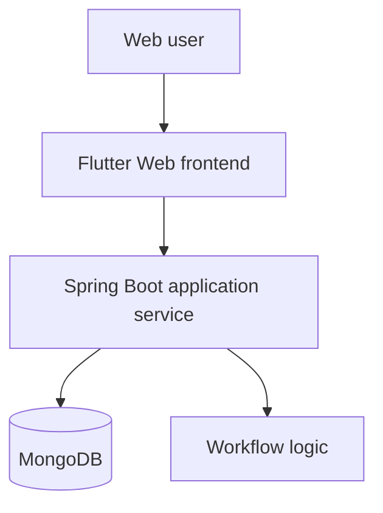

# DING Ticketing

**Request and workflow management platform for the University of Sassari (UNISS).**

DING Ticketing is a web application for submitting, reviewing, and tracking administrative requests. It provides a unified interface for users involved in institutional procedures and supports workflows with different responsibilities and approval steps.

## Overview

The project is organised into three main components:

- **Web application:** a responsive user interface for creating requests, viewing their status, and working with assigned tasks.
- **Application service:** a REST-based backend implementing business rules, request processing, authentication, and workflow logic.
- **Data storage:** a document database for application records and workflow information.

The components are packaged and managed using Docker Compose.

## Architecture



The frontend handles user interaction and communicates with the application service through REST APIs. The backend validates requests, applies business rules, coordinates workflow steps, and accesses persistent data. Deployment-specific networking and security controls are intentionally documented separately from this public overview.

## Technology stack

| Component | Technology | Purpose |
| --- | --- | --- |
| Frontend | Flutter Web, Dart | Browser-based application |
| Backend | Java, Spring Boot | REST services and business logic |
| Persistence | MongoDB | Document storage |
| Web serving | NGINX | Serving frontend assets |
| Packaging | Docker, Docker Compose | Reproducible builds and service management |
| Build | Maven | Java application packaging |

## Key features

- Submission and tracking of administrative requests.
- Role-aware user interfaces and procedure assignments.
- Multi-step workflow management.
- Centralised storage of request information.
- Browser-based access.

The exact operations available to each user depend on the workflow and the application configuration.

## Repository structure

```text
Uniss_Ticketing/
├── ticketing_webapp/      # Flutter Web source code
├── java_spring_boot/      # Java Spring Boot source code
├── MongoDB/               # Database-related project resources
├── retiPetri_procedure/   # Workflow-related resources
└── docker-compose.yml     # Container orchestration definition
```

Some deployments may include additional configuration files maintained outside the public source repository.

## Development and build

### Prerequisites

- Docker Engine and Docker Compose
- Git
- A Java and Maven toolchain compatible with the project, or an equivalent container-based build environment

### Get the source

```bash
git clone https://github.com/Dani-Picciau/Uniss_Ticketing.git
cd Uniss_Ticketing
```

If you maintain a fork, use your fork's repository URL instead.

### Build the backend

The backend container expects a compiled Java package. Build it from the backend project directory:

```bash
cd java_spring_boot
mvn clean package
cd ..
```

Check the project's Maven configuration for the required Java version and any environment-specific build requirements.

### Build the containers

```bash
docker compose build
```

The Compose configuration is intended as a starting point for development. Review its settings and provide environment-specific configuration before running it outside an isolated development environment. Do not assume that development defaults are suitable for production.

## Configuration

Configuration depends on the environment. In general, operators should ensure that:

- The frontend is configured to reach the application API through an appropriate URL.
- Application secrets and credentials are supplied securely and never committed to source control.
- Database storage is persistent and has a documented backup process.
- Network access, transport encryption, and access controls are reviewed before deployment.

Operational settings, infrastructure addresses, access procedures, and internal deployment diagrams belong in restricted operations documentation rather than this public README.

## Testing

Before releasing changes, run the automated tests available in the project and verify the main user flows, including authentication, request submission, status changes, and role-specific operations.

## Contributing

Contributions should be proposed through an issue or pull request. Include a clear description of the change and relevant tests. Avoid committing real user records, database exports, credentials, tokens, certificates, or environment-specific configuration.

## Project origin

Based on the original [Uniss_Ticketing repository](https://github.com/Dani-Picciau/Uniss_Ticketing).

## Documentation and security

This README contains only a high-level technical overview. Deployment instructions and security-sensitive operational details should be maintained in access-controlled documentation.

If you identify a security issue, report it privately to the project maintainers rather than opening a public issue with exploit details.
