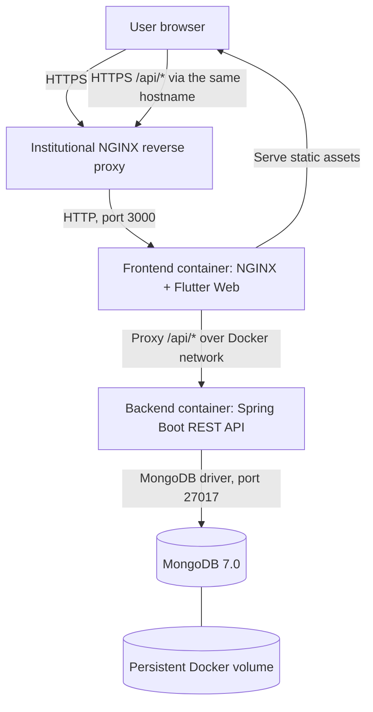

# DING Ticketing

**Web-based request and workflow management system for the University of Sassari (UNISS).**

DING Ticketing provides a browser-based interface for submitting and tracking administrative requests, managing procedures, and supporting role-based workflow steps. The application consists of a Flutter Web frontend, a Java Spring Boot REST API, and a MongoDB database. Docker Compose manages the services.

> **Deployment note:** This repository includes an application-level Docker Compose configuration. The UNISS deployment uses an additional NGINX reverse-proxy configuration to serve the frontend and `/api/` under the same HTTPS hostname.

## Architecture



The diagram represents the deployed request path: the browser sends both UI and API requests to one public hostname. The frontend container serves Flutter's static files and forwards `/api/` requests to the `backend` service on the private Docker network. MongoDB is not meant to be publicly reachable.

### Technology stack

| Layer | Technology | Responsibility |
| --- | --- | --- |
| Frontend | Flutter Web (Dart) | Browser UI and calls to REST endpoints |
| Web server | NGINX | Static assets and internal `/api/` reverse proxy in the UNISS deployment |
| Backend | Java 25, Spring Boot 4.1.0 | REST APIs, application logic, authentication, and workflow management |
| Authentication | Spring Security, JWT, BCrypt | User login, request authentication, and password verification |
| Database | MongoDB 7.0 | Users, procedure data, and application records |
| Deployment | Docker Engine, Docker Compose | Service builds, networking, lifecycle, and database volume |

### Services and ports

| Service | Internal port | Typical host port | Notes |
| --- | --- | --- | --- |
| `frontend` | 80 | 3000 | HTTP behind the institutional HTTPS proxy |
| `backend` | 8080 | 127.0.0.1:8080 in UNISS override | Reachable as `backend:8080` from the Docker network |
| `mongodb` | 27017 | None in UNISS override | Persistent storage through `mongo-data` |

**Important:** The original `docker-compose.yml` publishes backend port `8080` and MongoDB port `27018` on the host. Do not use those public bindings on an Internet-facing server without reviewing access controls. The UNISS deployment overrides them.

## Repository layout

```text
Uniss_Ticketing/
├── ticketing_webapp/        # Flutter Web application and frontend Dockerfile
├── java_spring_boot/        # Spring Boot backend, Maven project, Dockerfile
├── MongoDB/                 # JSON data files for optional manual import
├── retiPetri_procedure/     # Procedure / Petri-net materials
├── docker-compose.yml       # Base Docker Compose definition
├── docker-compose.override.yml   # UNISS-specific override, if included
└── nginx/                   # UNISS-specific frontend reverse-proxy config, if included
```

Deployment-specific files are optional and may exist only in the UNISS fork. The original upstream repository does not necessarily include them.

## Requirements

- Docker Engine with Docker Compose plugin.
- Git.
- An AMD64-compatible host is supported by building the images from source.
- Network connectivity to container registries for the initial build.
- A working Java 25/Maven build environment **or** a temporary Maven Docker image to compile the backend JAR.

The backend Dockerfile copies an **already compiled** JAR from `java_spring_boot/target/`. The backend must therefore be packaged before `docker compose build`.

## Quick start

### 1. Clone the repository

```bash
git clone https://github.com/Dani-Picciau/Uniss_Ticketing.git
cd Uniss_Ticketing
```

If deploying from a fork, replace the URL with that fork's URL.

### 2. Build the backend JAR

For hosts without Java or Maven installed, build in a temporary container:

```bash
docker run --rm \
  -v "$PWD/java_spring_boot:/app" \
  -w /app \
  maven:3.9-eclipse-temurin-25 \
  mvn clean package -DskipTests
```

Confirm that `java_spring_boot/target/*.jar` exists. This quick-start command skips tests; run the project's test suite before production release.

### 3. Configure the frontend API URL

The Flutter frontend uses `ApiConstants.baseUrl` in:

```text
ticketing_webapp/lib/constants/api_constants.dart
```

For the UNISS deployment, use:

```dart
static const String baseUrl = 'https://ding-ticketing.uniss.it';
```

The public API URL must not point to `http://localhost:8080`: in a web browser, `localhost` means the **user's computer**, not the application server. Flutter Web builds the URL into its generated client files, so changing it requires rebuilding the frontend image.

For other deployments, set this value to the HTTPS origin where the application and its `/api/` paths are served.

### 4. Configure the UNISS reverse proxy (deployment-specific)

Use this NGINX configuration as `nginx/default.conf` on the Docker host:

```nginx
server {
    listen 80;
    server_name _;

    root /usr/share/nginx/html;
    index index.html;

    location / {
        try_files $uri $uri/ /index.html;
    }

    location /api/ {
        proxy_pass http://backend:8080;
        proxy_http_version 1.1;
        proxy_set_header Host $host;
        proxy_set_header X-Real-IP $remote_addr;
        proxy_set_header X-Forwarded-For $proxy_add_x_forwarded_for;
        proxy_set_header X-Forwarded-Proto $http_x_forwarded_proto;
    }
}
```

Note the lack of a trailing slash in `proxy_pass http://backend:8080;`: the original `/api/...` path is preserved for Spring Boot.

Keep the upstream Compose file unchanged and place the following in `docker-compose.override.yml` (requires a Docker Compose release that supports `!override`):

```yaml
services:
  mongodb:
    ports: !override []

  backend:
    ports: !override
      - "127.0.0.1:8080:8080"

  frontend:
    volumes:
      - ./nginx/default.conf:/etc/nginx/conf.d/default.conf:ro
```

The external institutional NGINX proxy terminates HTTPS and forwards requests to the host's port `3000`. Only that port needs to be reachable from the proxy. Restrict the network rule to the proxy's source address.

### 5. Build and start

```bash
docker compose config
docker compose build
docker compose up -d
docker compose ps
```

Inspect logs:

```bash
docker compose logs --tail=100 backend
docker compose logs --tail=100 frontend
```

In the UNISS deployment, the application is available at **https://ding-ticketing.uniss.it** when DNS, the institutional reverse proxy, and firewall rules are configured.

## Authentication and application roles

The backend implements login through `POST /api/auth/login`. It finds users by email and compares the submitted password with the stored BCrypt hash. Successful authentication returns a JWT, which is used on subsequent API requests.

The user model stores an array of roles. The defined role identifiers are:

| Role | Intended responsibility |
| --- | --- |
| `DOCENTE_RICHIEDENTE` | Opens or submits a procedure |
| `RUP` | Handles administrative procedure steps |
| `DIRETTORE` | Acts on steps requiring departmental director involvement |

Roles are associated with workflow nodes. **Do not assume every route is protected by a role-specific backend authorization check.** Review service/controller authorization before treating role-based UI visibility as a security boundary.

The default security configuration currently allows unauthenticated access to `/api/auth/login` and `/api/auth/hash`, while requiring authentication for other requests. The public hash-generation endpoint is intended for development and should be removed before production deployment.

## Database

MongoDB is reached by the backend using the Compose service name:

```text
mongodb://mongodb:27017/Prova
```

The data lives in the named Docker volume `mongo-data` and persists through normal container recreation.

To inspect the database from the Docker host:

```bash
docker compose exec mongodb mongosh Prova
```

Useful read-only checks:

```javascript
show collections
db.Utenti.countDocuments({})
db.Utenti.find({}, { passwordHash: 0 }).pretty()
```

The `MongoDB/` folder includes JSON files such as `Prova.Utenti.json` and workflow templates. These are **not automatically imported by Docker Compose**. Review each file before importing it, especially if the database already contains records. Do not publish actual user data or passwords in the repository.

### Backup

```bash
docker compose exec -T mongodb \
  mongodump --db Prova --archive --gzip \
  > "backup_prova_$(date +%Y%m%d_%H%M%S).archive.gz"
```

Store database backups securely and test restoration before depending on them. Never run `docker compose down -v` unless you explicitly intend to remove Docker volumes and their data.

## Updating the deployment

Fetch and review changes before rebuilding:

```bash
git fetch origin
git status -sb
```

After integrating the desired changes, build the backend JAR again **if Java sources or dependencies changed**:

```bash
docker run --rm \
  -v "$PWD/java_spring_boot:/app" -w /app \
  maven:3.9-eclipse-temurin-25 \
  mvn clean package -DskipTests
```

Then rebuild and recreate the affected application services:

```bash
docker compose build
docker compose up -d
```

Before updating a live instance, back up MongoDB and check whether the updated code requires data migration. Keep production-specific overrides separate from upstream code whenever possible.

## Troubleshooting

| Symptom | Likely cause | Check |
| --- | --- | --- |
| `502 Bad Gateway` on the public hostname | The institutional NGINX proxy cannot reach a valid upstream response | Check frontend container, port 3000, upstream HTTP target and firewall |
| Login request tries `localhost:8080` | Flutter was built with the development API URL | Update `ApiConstants.baseUrl` and rebuild frontend |
| Browser reports mixed content | HTTPS page is requesting an HTTP API | Use the same HTTPS origin and reverse-proxy `/api/` |
| `404` on `/api/...` | Frontend NGINX is serving a web page rather than forwarding the API | Check `/api/` location and NGINX mounting |
| `401 Unauthorized` from `/api/auth/login` | Invalid credentials, absent user, or another authentication rejection | Inspect response and verify the user exists in `Prova.Utenti` |
| JAR missing during backend image build | Maven package step was skipped | Compile `java_spring_boot` before Docker build |

Local health checks:

```bash
curl -I http://127.0.0.1:3000
curl -i -X POST http://127.0.0.1:3000/api/auth/login \
  -H 'Content-Type: application/json' \
  -d '{"email":"nonexistent@example.invalid","password":"test"}'
```

The second request should reach the application API and normally return an authentication error for the nonexistent account, not a proxy error. Do not put real passwords into shell history.

## Security checklist

Before using DING Ticketing with real institutional data:

- Restrict public access to the HTTPS reverse proxy; do not expose MongoDB or the backend API port directly to the Internet.
- Remove or restrict the development-only `/api/auth/hash` endpoint.
- Set and protect a strong JWT signing secret; do not commit secrets to Git.
- Configure MongoDB authentication and appropriate network isolation.
- Review role-specific authorization checks on all sensitive API operations.
- Restrict CORS settings to approved origins where cross-origin access is required.
- Enable reliable database backups and define a restore procedure.
- Check logs and test all user roles and workflow transitions before release.

## Source and deployment

Original source: [Dani-Picciau/Uniss_Ticketing](https://github.com/Dani-Picciau/Uniss_Ticketing).

UNISS deployment: [https://ding-ticketing.uniss.it](https://ding-ticketing.uniss.it).

This README documents the application architecture and the known UNISS deployment setup. Review all configuration values against the environment where the software is actually deployed.
